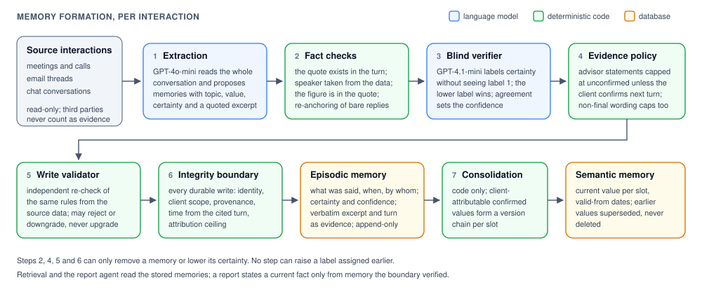

# Cognitive Memory Fabric: demonstration and evaluation notes


Cognitive Memory Fabric (CMF) is a research prototype of long-term memory for an AI assistant that supports financial advisors. It reads the original client conversations (meetings, calls, email and chat) and builds a memory in which every item is dated, labelled with how settled it is, and linked to the exact sentence it came from. This document describes the data, the memory formation pipeline, a guided walkthrough of the running system, and the evaluation results, including the cases the system still gets wrong.

All data is synthetic: six fictional clients, three fictional advisors, January to September 2026.

---

## 1. Problem

A client's position on a financial question changes over months and is spread across channels. In the dataset, the system of record (a CRM) holds 166 records for the six clients; 153 are automatic log lines ("meeting logged") and 13 are notes an advisor typed from memory. Some of those notes are wrong. One records that a client "accepted the offer" for her company while the conversations show she was only inclined to accept; the note was never corrected.

An assistant that reads such a summary inherits its errors. CMF instead reads the conversations themselves and keeps three properties for every memory:

- **Provenance:** the interaction, turn and verbatim excerpt that support it.
- **Certainty:** `confirmed`, `correction`, `exploratory`, `hypothetical`, `unconfirmed` or `recommendation`, with a measured confidence.
- **Time:** the date of the statement; later values supersede earlier ones without deleting them.


## 2. Data

| Source | Interactions | Turns or messages | Used for memory |
|---|---|---|---|
| Meetings and calls (`data/conversations.csv`) | 150 | 2,199 | yes |
| Additional generated meetings (`datasets/meetings`) | 11 | 160 | yes |
| Email threads (`datasets/emails`) | 21 | 78 | yes |
| Chat conversations (`datasets/chats`) | 27 | 89 | yes |
| CRM records (`datasets/crm`) | 166 | n/a | no; shown for comparison only |
| **Simulated continuation** (`data/simulation`, section 5) | 25 | 230 | only when ingested in the demonstration |

Records flagged as restricted in `datasets/governance/source_control.csv` are excluded. Messages from third parties (for example a client's accountant) are kept as context but can never serve as evidence for a client memory. The original record ends on 30 June 2026; the simulated continuation covers July to September 2026.

Answer keys:

- **Scripted set.** `reports/generation_manifest.json` lists the outcomes each scripted meeting was written to contain.
- **Natural-wording set.** 60 of those meetings were rewritten by `gpt-4.1` without the stock recap phrases (`scripts/make_paraphrased_set.py`). Every fact, figure and decision status is kept.
- **Simulated set.** `data/simulation/sim_manifest.json` lists the outcomes the generator reports having planted.

## 3. Memory formation



Each interaction passes through seven steps.

1. **Extraction (language model).** `gpt-4o-mini` reads the whole conversation and proposes memory candidates: topic, value, certainty, speaker and a quoted excerpt.
2. **Fact checks (code).** The quote must exist in the cited turn. The speaker is taken from the data, not from the model. A figure must appear in its quote. A bare reply such as "Yes, let's do that" is re-anchored to the earlier sentence that states the content. A client's own sentence that states a figure is never re-anchored to the advisor.
3. **Blind verifier (language model).** `gpt-4.1-mini` assigns its own certainty label without seeing the extractor's label. The lower label wins, and the agreement pattern sets the confidence score.
4. **Evidence policy (code).** An advisor's statement about the client's decision is stored as at most `unconfirmed`, unless the client's immediate reply confirms it ("That's right."). Then that reply is stored as supporting evidence. Wording that marks a matter as not final ("I haven't decided", "don't treat it as final yet") also caps the certainty. An unresolvable case is capped and flagged for review rather than guessed.
5. **Write validator (code).** An independent component recomputes the same checks from the source data and may reject or lower a candidate.
6. **Integrity boundary (code).** Every durable write is checked for the writer's identity and client scope, resolvable provenance, observation time taken from the cited turn, and the same attribution ceiling.
7. **Consolidation (code).** Only confirmed, client-attributable values form the current value of a slot (for example *retirement age*). A new value supersedes the previous one with a valid-from date; nothing is deleted.

Steps 2 and 4–6 can only remove a candidate or lower its certainty; no step raises a label assigned earlier. The model never writes to the memory store directly.


Memory types: **episodic** (each statement, its speaker and its date), **semantic** (current values per slot, with their version history), **procedural** (curated procedures and advisor-proposed ones awaiting approval) and **working** (short-lived analysis state of one request).

## 4. Running the demonstration

```bash
cp data/seed/cmf_memory_llm_first.db build/cmf_memory_llm_first.db   # working copy; the seed stays unchanged
PYTHONPATH=src .venv/bin/python -m api.main                           # API on 127.0.0.1:8000, development profile
cd ui/cmf-brain-ui && npm run dev                                     # UI on http://localhost:5173
```

The `.env` file must set `CMF_MEMORY_DATABASE_URL=sqlite:///build/cmf_memory_llm_first.db`, `CMF_MEMORY_CHANNELS=all`, `CMF_INGEST_MODE=llm_first` and `OPENAI_API_KEY`. The key is used only by *Ask CMF* and *Simulate*; browsing the pre-built memory needs no model calls. Copying the seed again resets every change, including simulated ingestions.

Views:

- `http://localhost:5173/#/data`: the raw sources, the CRM layer and storyline-by-storyline comparisons.
- `http://localhost:5173`: the memory graph per client, with four panels: *Memory Dossier*, *Ask CMF*, *Sources & Lifecycle* and *Simulate*.
- `http://localhost:5173/#/architecture`: an interactive version of the diagram above.

## 5. Walkthrough

### 5.1 Retirement age across four channels (client Kenji, CLIENT-001)

Storyline: the planning date is 65; Kenji explores retiring at 60; the advisor's email overstates that exploration; Kenji corrects it; he later decides on 63.

| Date | Source | Source text | Memory formed |
|---|---|---|---|
| 9 Feb | meeting INT-027, turn 8 | Kenji: "Let's say I'm leaning toward 60 for now, but I'm not committing to it." | 60, **exploratory**, confidence 0.96. The CRM note typed after this meeting reads "Kenji would like to retire at 60." |
| 10 Feb | email THR-002 | Advisor: "As discussed, you'd like to retire at 60…" Kenji replies: "I'd like to see what part-time consulting at 60 would have to earn." | 60, **exploratory**, cited to Kenji's reply. The advisor's overstatement is not stored as a client decision (step 4). |
| 4 Mar | call INT-049, turn 4 | Kenji: "I should clarify that. I was only exploring the possibility." | exploratory; the advisor's file note is corrected in the same call |
| 5 Mar | chat CHT-001 | "Formal planning date is 65; 60 is recorded as something you're exploring." | 60, exploratory, confidence 0.96 |
| 1 May | meeting INT-090, turn 2 | Kenji: "We've decided: 63." | 63, **confirmed**, confidence 0.96 |

Resulting semantic memory: **retirement age 63, valid from 1 May 2026**, superseding 65 (valid from 2 January). Both versions cite Kenji's own words. In the graph view, the node *retirement age (semantic)* opens a dossier with the version history, the evidence sentence and the lifecycle audit trail. An advisor can dispute or expire a memory there; the change is recorded, not applied silently.

A previous build, without the step-4 policy, stored the advisor's email as a **confirmed** 60. The version history then read 65 → 60 → 65 → 63, with an incorrect value current for three weeks.

### 5.2 A company sale and an uncorrected CRM note (client Rebecca, CLIENT-002)

| Date | Source | Source text | Memory formed |
|---|---|---|---|
| 11 Mar | meeting INT-052 | "I'm inclined to say yes, but I'm nervous about the earn-out and the rollover." | **exploratory**, 0.96 |
| 12 Mar | email THR-006 | Advisor: "You told me you are inclined to accept; you have not signed the letter of intent." Rebecca: "Keep it that way until I sign: inclined, not accepted." | exploratory. The CRM summary of the same thread reads "Client accepted the offer." and was never changed. |
| 24 Mar | meeting INT-058 | "I said I was inclined to accept… I haven't signed." | exploratory |
| 17 Apr | meeting INT-077 | "Twenty-two. Below twenty-two I walk." | walk-away price 22 (USD millions), **exploratory**, 0.86: a negotiating position, not a decision to sell |
| 22 Apr | meeting INT-083 | "I've decided. I'm going to sell to Lakeshore." | **confirmed**, 0.96 |

Rebecca's care costs show slot separation: a monthly care cost (6,000 USD per month) and a one-off care reserve (600,000 USD) are two different slots, so neither overwrites the other.

### 5.3 New interactions arriving (tab *Simulate*)

The tab lists the selected client's queued interactions from `data/simulation/`, in date order. It shows the next one with its full transcript. **Ingest into memory** adds that interaction to the conversation source and runs steps 1–7 on it. The graph then reloads with the new memories highlighted. Ingestion takes 10–30 seconds and two model calls. The tab is not available in the production profile, and the server refuses to ingest an interaction out of date order.

Example, SIM-001 (email, 12 July 2026). The advisor asks about open items and restates a plan: "On Yuki, I'll leave the thirty-thousand cap as a plan unless you tell me otherwise… is that right?" Kenji answers: "Mostly right, but I did tell her she probably shouldn't make a decision just for the money." In one live run, the system stored four episodic memories:

| Memory | Certainty | Source |
|---|---|---|
| Kenji told Yuki not to decide for the money alone | confirmed, 0.82 | Kenji's sentence |
| Yuki is undecided between the graduate programme and the job | exploratory, 0.86 | Kenji's sentence |
| Kenji retrieved the beneficiary forms and will review them | confirmed, 0.82 | Kenji's sentence |
| A 30,000 USD cap for Yuki's graduate programme | **unconfirmed**, 0.40 | the advisor's sentence; the client only partly accepted it |

The last row illustrates step 4: a figure stated by the advisor and only partly accepted by the client is kept, with its source, but is not promoted to a current value. Model outputs vary between runs, so a repeated ingestion can differ in detail.

### 5.4 Asking questions (tab *Ask CMF*)

*Ask CMF* runs a planner, memory retrieval, a tool selector over the operational data and a report agent, all under a harness that enforces permissions, budgets and evidence verification. The report agent states a current fact only from memory that the integrity boundary marked **verified**. Verification is sentence-level matching against the source. Most model-extracted memories paraphrase their source and do not pass it, so answers are usually presented as evidence plus open items rather than a definite statement. This is a known limitation (section 7), not a defect of a single run. A question that touches suitability or forecasting is held for human approval. The UI then shows which agents ran and which permission checks passed, without revealing any content.

## 6. Evaluation

**Method.** Both ingestion pipelines run on each set up to the validated candidate list; nothing is written to a memory store. The **rules** pipeline is the earlier regex-salience and rule-guard baseline. A blind judge (`gpt-4.1`) matches candidates to the answer key. It sees a shuffled, unlabelled mix of both pipelines' outputs.

- *Recall* is the share of authored outcomes found.
- *Certainty accuracy* is the share of matched outcomes whose label is right: a decision or plan must be `confirmed`, a tentative option `exploratory` or `hypothetical`, a correction `correction`.
- *Over-confident* counts tentative outcomes stored as confirmed, the costlier error.

Model responses are cached (`build/eval/llm_cache.json`), so a re-run with unchanged prompts is deterministic.

| Set | Pipeline | Recall | Certainty accuracy | Over-confident | Under-confident |
|---|---|---|---|---|---|
| Scripted, 150 interactions (135 outcomes) | rules | **0.911** | 0.781 | 0 | 13 |
| | LLM-first | 0.837 | **0.825** | 0 | 9 |
| Natural wording, 60 interactions (74 outcomes) | rules | 0.662 | 0.400 | 0 | 16 |
| | LLM-first | **0.730** | **0.745** | 0 | 3 |
| Simulated continuation, 25 interactions (77 outcomes) | rules | 0.234 | 0.438 | 0 | 5 |
| | LLM-first | **0.558** | **0.568** | 0 | 11 |

Observations:

- **The rules pipeline depends on the scripted wording.** It leads on recall only on the scripted set, whose recap phrases its patterns were written for. On natural wording its certainty accuracy falls to 0.40, and on the simulated set its recall falls to 0.23.
- **No over-confident labels.** Neither pipeline stored a tentative outcome as confirmed on any set after the write validator. Before the validator, LLM-first produced one such case on the scripted set and two on the simulated set.
- **The write validator costs LLM-first recall.** Before the validator, LLM-first recall is 0.941, 0.851 and 0.636 on the three sets. The validator compares a statement with one quoted sentence, so memories that combine two turns ("Does she have a scholarship?" / "A small one.") are rejected.
- **The simulated set is harder.** It contains more plans and corrections expressed indirectly. LLM-first finds 11 of 12 decisions, but only 13 of 26 plans, and labels 1 of 6 matched corrections as corrections.

**Effect of the evidence policy (step 4).** The policy was added to the system during this evaluation; earlier reports are in the git history.

| LLM-first, certainty accuracy | Without step 4 | With step 4 |
|---|---|---|
| Scripted, 150 | 0.894 | 0.825 |
| Natural wording, 60 | 0.792 | 0.745 |

The policy lowers measured accuracy because some genuine confirmations are not recognised. A typical case is an affirmation followed by a remark about a different open item: "Correct, including what's still open." The policy abstains there rather than guess. In return, an advisor's account is never stored as a client-confirmed fact. In the demonstration memory, two advisor read-outs that the previous build stored as current values (a client's monthly spending of 14,500 USD and another client's cash holdings of 210,000 USD) are no longer current values. The list of recognised confirmations was extended after inspecting misses on the scripted and natural-wording sets. Those two sets are therefore not fully independent of this tuning; the simulated set was generated afterwards and was not used for it.

Reports: `reports/llm_first_eval.md`, `reports/llm_first_eval_subset_original.md`, `reports/llm_first_eval_paraphrased.md`, `reports/llm_first_eval_simulation.md`.

## 7. Limitations

- **Definite answers.** Because of sentence-level verification, *Ask CMF* rarely states a current fact from model-extracted memory. Entailment-based verification is the open design question.
- **Single-sentence support check.** This check accounts for most of the recall gap between LLM-first before and after the write validator. Checking a statement against all its cited evidence rows is the proposed change; it has not been made.
- **Residual value errors.** In the demonstration memory, a gift of "up to fifteen" (thousand) is stored as 15, and one client's home purchase price is stored as 40,000 USD (the size of a house fund) instead of 600,000 USD. An earlier build had the price right; the extractor's output for that meeting varies between runs.
- **Weak agreement.** Replies such as "Okay, that's consistent with my own numbers" are read as agreement.
- **Synthetic data only.** The conversations, the answer keys and the paraphrases are model-written or scripted. Precision is not measured beyond a check that routine records yield no invented memories. All figures need re-measurement on real, consented and anonymised conversations before any conclusion about deployment.
- **Shared-model bias.** The judge (`gpt-4.1`) also generated the natural-wording and simulated sets.
- **Run-to-run variation.** Extraction varies between runs even at temperature 0. Production recall on the scripted set has ranged from 0.84 to 0.90 across prompt versions.

## 8. Reproduction

```bash
PYTHONPATH=src .venv/bin/python -m pytest tests/ -q                                           # test suite (temporary databases only)
PYTHONPATH=src .venv/bin/python scripts/eval_llm_first.py                                     # scripted set
PYTHONPATH=src .venv/bin/python scripts/eval_llm_first.py --conversations build/eval/paraphrased_conversations.csv --out reports/llm_first_eval_paraphrased
PYTHONPATH=src .venv/bin/python scripts/eval_llm_first.py --conversations data/simulation/sim_conversations.csv \
    --manifest data/simulation/sim_manifest.json --out reports/llm_first_eval_simulation
PYTHONPATH=src .venv/bin/python scripts/generate_synthetic_conversations.py --per-client 4 --max-usd 10   # new simulated interactions
PYTHONPATH=src .venv/bin/python scripts/generate_images.py                                    # illustrations in docs/images
```

Run the evaluation commands with `CMF_MEMORY_CHANNELS` empty, so that only the sets above are scored. Rebuilding the demonstration memory for all six clients and all channels takes about 20 minutes, with about two model calls per interaction plus one value check per confirmed figure (`gpt-4o-mini` and `gpt-4.1-mini`):

```bash
export CMF_MEMORY_DATABASE_URL=sqlite:///build/new.db CMF_INGEST_MODE=llm_first CMF_MEMORY_CHANNELS=all PYTHONPATH=src
.venv/bin/python -m orchestration.cli init-memory
for c in CLIENT-001 CLIENT-002 CLIENT-003 CLIENT-004 CLIENT-005 CLIENT-006; do .venv/bin/python -m orchestration.cli ingest --client $c; done
```

Further design notes: `docs/llm_first_ingestion.md` (pipeline and measurements), `docs/m1_attribution_safety_report.md` (evidence policy), `docs/harness.md` (permissions and verification), `docs/dataset_design.md` (data generation).

*The older presenter version of this walkthrough (`CMF_Demo_Script.docx`) predates the evidence policy, and several of its figures no longer apply.*
