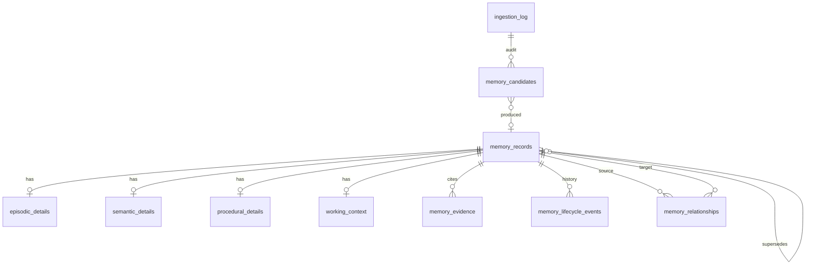

# Build prompt: Memory Orchestrator Agent (CMF)

> **What this file is.** A build specification ("prompt") for the Memory Orchestrator Agent. It tells an implementer what to build and what rules to follow.
> It is **not** documentation of existing code: at the time of writing the repository contains the Planner Agent, the frozen conversations, the synthetic
> operational data (`cmf_ops`) and its access layer only. Everything below is **to be built** unless it says "exists".
> "Lessons" notes record problems seen in an earlier build of this agent (since removed), so they are not repeated.

## 0. Context and constraints

* Existing and must not change: `data/conversations.csv` (frozen: 6 clients, 3 advisors, 150 meetings, 2,199 turns), `data/operational/*` and schema `cmf_ops`
  (synthetic, 13 tables), `src/cmf_data/` (read-only access layer), `src/agents/planner/`, `src/llm/client.py` (Qwen2.5 via local Ollama, default `qwen2.5:3b`).
* LLM: Qwen2.5 through the shared client only. Structured JSON output validated with pydantic; invalid output is retried with the error, then falls back safely.
* Memories are stored in **PostgreSQL schema `cmf_memory`**, separate from `cmf_ops`. Develop on SQLite first behind one database-switch module
  (`CMF_MEMORY_DATABASE_URL`: `sqlite:///...` or `postgresql://...`); use portable SQL; do not claim PostgreSQL works until it has run on a live server.
* The LLM never receives credentials and never executes SQL. It proposes structured operations; a Python `MemoryStore` validates and persists them.
* Never fabricate evidence: every conversation-derived memory must reference a real `interaction_id` + `turn_index` and an excerpt that exists in that turn.

## A. Purpose and architectural role

The Memory Orchestrator turns raw evidence into **structured, versioned, evidence-linked knowledge** about each client, and reconstructs the right slice of it for a task.
It is the component that maintains each client's evolving **Cognitive Digital Twin**: not a copy of the transcripts but a model of what happened, what is currently known,
what was only explored, what was corrected and what is still open.

It is not a conversation-history search because: it decides *what deserves memory* (most turns do not); it separates a decision from an exploration; it keeps superseded
values traceable instead of overwriting them; it links related memories; and it returns a compact, task-specific context package instead of transcripts.

**Inputs (two sources, both must be supported):**
1. *Conversation evidence* (`conversations.csv`, turn level with meeting context) for the ingestion workflow.
2. *Tool Selector output and task context* for the retrieval workflow and for working memory: tool results and the Planner's plan are categorised into the same four
   buckets (see B). Tool-derived numbers come from synthetic `cmf_ops` data and **must never be stored as something the client said**.

**Interfaces with other agents**
| Agent | Direction | Contract |
|---|---|---|
| Planner | Planner -> Memory | `ExecutionPlan` (client_ids, memory_topics, required_memory_categories, task_type, time_period) |
| Memory -> Tool Selector | `MemoryContext` per client (current understanding, history, episodes, procedures, working, relations, contradictions, unresolved) |
| Tool Selector -> Memory | tool execution summaries and the task context, stored as working memory for the request |
| Memory -> Report Agent | the same `MemoryContext` with evidence excerpts |

## B. Memory architecture: four buckets, assigned dynamically

Each input is classified **dynamically** into one or more buckets by the LLM proposal plus deterministic rules (see D); there is no fixed per-source routing.
Common table `memory_records` (with `memory_type`) plus one detail table per type.

### 1. Episodic memory: "what happened"
* **Represents:** a specific event in a specific meeting or task (a decision, an exploration, a correction, a recommendation, a request).
* **Stores:** client_id, interaction_id, turn_index, event date, speaker role, topic, subject, one-sentence statement, optional key value, certainty, confidence, status, excerpt evidence.
* **Created by:** ingestion. Every candidate that passes validation becomes one episodic memory. Examples: Kenji, 2026-01-16, exploratory, "considering retiring at 60";
  Rebecca, 2026-03-26, confirmed, "declined the employee-ownership route because a ten-year seller note would not give the certain cash needed for her mother's care".
* **Retrieved:** by client + topic + time (`as_of`), ranked by certainty weight and keyword relevance, shown chronologically.
* **Lifecycle:** immutable content; status `active`, or `unconfirmed`; becomes `superseded` only when it was a wrongly recorded *confirmed* decision that a later correction replaces.

### 2. Semantic memory: "what we currently know"
* **Represents:** consolidated, relatively stable knowledge: one current value per slot (topic + subject), versioned. Example: Kenji `retirement_age = 63` valid from 2026-05-01.
* **Stores:** slot key, value, validity (`valid_from`, `valid_to`), `version_no`, `supersedes_id`, basis, count of supporting episodes, and copies of the conversation evidence.
* **Created by:** consolidation only, never directly by the model. A *confirmed* decision (or a correction that states a value) with a value different from the current one creates a new version.
* **Retrieved:** current (active, or valid at `as_of`) plus the superseded chain as history.
* **Lifecycle:** `active` -> `superseded` (with `valid_to` set) when a newer confirmed value arrives. Never deleted.

### 3. Procedural memory: "how should this be done"
* **Represents:** approved, reusable procedures (e.g. retirement readiness review: retrieve confirmed target, retrieve profile/portfolio/goals, compute simple funding gap, state it is not a projection).
* **Stores:** procedure name, steps, topics/keywords, `approval_status` (`proposed`/`approved`/`rejected`), approver, source reference.
* **Created by:** (a) a curated, versioned file loaded as `approved` (not from conversations; label it as such); (b) an advisor turn may *propose* a procedure, stored as `candidate`/`proposed`.
  A client statement can never create a procedure. Do not classify ordinary advisor instructions as procedures.
* **Retrieved:** only `approved` procedures matching the plan's topics or request keywords.
* **Lifecycle:** proposed -> approved/rejected by an explicit human action (`update_memory_lifecycle`).

### 4. Working memory: "what is relevant right now"
* **Represents:** temporary context for one request/session: the values being used (e.g. "analysis uses retirement age 63, from MEM-SEM-..."), intermediate facts, pending confirmations.
* **Stores:** session_id, task/plan id, content, derived-from memory id, `expires_at`.
* **Created by:** the orchestrator when it builds the task context, and from the Tool Selector's summaries for the same session.
* **Retrieved:** only for the same session while not expired.
* **Lifecycle:** `active` -> `expired` after the TTL (default 4 h). **Never promoted** automatically to semantic memory.

## C. Pipeline (build exactly these stages; each stage is a testable function)

| Stage | What happens | Suggested module | Data in -> out | Safeguards |
|---|---|---|---|---|
| 1 Ingestion + filtering | Score turns (decision, correction, exploration cues; client intent; topic words; figures). Drop greetings, acknowledgements and routine templates (portfolio read-outs, spending averages: that is operational data). Keep key sentences only. | `ingest.select_salient_turns`, `rules.py` | meeting turns -> selected turns/snippets | configurable `FilterConfig`; selection reasons logged |
| 2 Candidate extraction | One LLM call per meeting returns candidates: topic (fixed vocabulary), subject, statement, value, certainty, speaker role, turn_index, excerpt, corrects_value, reusable_procedure. | `ingest.extract_memory_candidates` | snippets -> `ExtractionResult` | schema validation, 2 retries |
| 3 Validation | cited turn must have been shown; speaker role taken from data; excerpt must exist in the turn (or repaired to the closest real sentence); topic from lexicon if model says "other"; value dropped if unsupported by text; **certainty guard** (D); duplicate merge; low-relevance reject | `ingest.filter_memory_candidates` | candidates -> decisions (accepted/downgraded/merged/rejected) | every candidate and reason stored in `memory_candidates` |
| 4 Classification + routing | Choose buckets; decide status; flag procedural proposals for review | `ingest.classify_memory`, `route_memory` | accepted candidate -> memory types | procedures only from advisor turns, only as proposals |
| 5 Consolidation | Fold each slot's episodes in time order into semantic versions | `consolidate.Consolidator` | episodes -> semantic versions | idempotent; deterministic |
| 6 Association | `derived_from`, `supersedes`, `corrects`, `explores`, `supports`, `follows`, `related_to` | `consolidate.py` | memories -> relationships | unique constraint prevents duplicates |
| 7 Temporal validation | validity windows must not overlap in a slot; a version never starts before its supporting evidence date; superseded items get `valid_to` | store + tests | semantic chain -> checked chain | CHECK constraints + tests |
| 8 Persistence | one transaction per memory; lifecycle event appended | `MemoryStore` | validated memory -> rows | evidence re-verified against the CSV before insert |

Ingestion is idempotent (one `ingestion_log` row per meeting; re-runs skip completed meetings) and independent of advisor requests.
A rule-based **recall safety net** is recommended for a small model: the advisor's recap wording ("You've decided...", "still weighing... idea and not an instruction",
"I've corrected my own record", "The working plan I'm recording is...") is high precision; if the model missed such a sentence, add a rule candidate (`origin = conversation_rule`) that passes the *same* validation.

## D. Classification and interpretation

| Kind | Certainty value | How it is recognised | Effect |
|---|---|---|---|
| Client decision | `confirmed` | decision wording in the excerpt ("we've decided", "let's", "go ahead", agreed plan) | episodic; may create/replace a semantic version |
| Explicit client statement (fact) | `confirmed` or `unconfirmed` | client turn, no hedging | episodic; semantic only if it states a value for a slot |
| Advisor recommendation | `recommendation` | advisor turn proposing, not yet accepted | episodic only |
| Exploratory | `exploratory` | "still weighing", "idea and not an instruction", "maybe", "what if", "leaning" | episodic only; linked with `explores`; never changes semantic value |
| Hypothetical | `hypothetical` | if-scenarios | episodic only |
| Unconfirmed | `unconfirmed` | unclear or unsupported | status `unconfirmed`; episodic only |
| Correction | `correction` | "corrected my own record", "was too strong", "I should clarify" | links to the corrected claim with `corrects`; supersedes it only if that claim was a recorded *confirmed* decision |
| System-generated inference | `n/a` (working memory) | produced by the system from tool results or consolidation | never stored as a client statement; working or semantic-by-consolidation only |

**Guard against incorrect promotion (must be implemented in code, not only in the prompt):** after the model answers, re-classify certainty from the *excerpt*:
exploratory or hypothetical wording and no decision wording => downgrade to `exploratory`; no decision wording at all => downgrade `confirmed` to `unconfirmed`;
a "correction" without correction wording => downgrade. Upgrades are never allowed. Semantic memory is written only by consolidation from `confirmed`/`correction` episodes with a value
(numeric topics such as `retirement_age` require a numeric value). Remove over-broad decision cues (an earlier build treated "Keep the maybes as maybes" as a decision).

## E. Routing and retrieval

Pipeline: client filter -> memory-type filter (from the plan's categories) -> topic filter (plan topics; otherwise a keyword lexicon on the request) -> status filter (active by default;
history includes superseded) -> temporal filter (`as_of`) -> relevance ranking (certainty weight + keyword overlap; keep one function as the extension point for embeddings) -> related memories
(relationships among the returned items) -> `MemoryContext`.
Follow-up requests without a topic scan all topics but only surface open items. Cap episodes (default 8) and say how many were omitted; never return a client's full history.
Another client's memories are never returned.

**Example (Kenji, "What is his current retirement target, and how did it evolve?"):** topics `retirement_age`. Returned: current `63` (valid from 2026-05-01, evidence INT-090 turn 2);
history `65` (superseded, valid until 2026-05-01); episodes in order (2026-01-16 exploratory 60, 2026-03-04 correction "60 was exploratory, 65 remains the planning date",
2026-04-16 exploratory 63, 2026-05-01 confirmed 63); unresolved list empty because the explorations were settled by the decision; unrelated topics (equity allocation, Northgate shares) not returned.

## F. Consolidation, association and temporal evolution

Per slot, in time order: a confirmed value different from the current one => new semantic version, previous `superseded` (`valid_to` = new `valid_from`), `supersedes_id` chain;
same value restated => `supports` relationship, no new version; exploratory/hypothetical/recommended => `explores` link to the current semantic memory; correction => `corrects` link, status change only per D.
**Kenji:** 2026-01-02 confirmed 65 (working plan) -> v1 `65`; 2026-01-16 and 2026-02-09 exploratory 60 (episodic only); 2026-03-04 correction (60 was exploratory, 65 remains) => reinforces v1, no new version;
2026-04-16/22 exploratory 63; 2026-05-01 confirmed 63 => v2 `63` active, v1 superseded. All episodes remain; evidence is traceable at every step.
Conflicting confirmed statements on the same day are treated as the same event (merged), not as two versions. Mark a memory `disputed` only through an explicit lifecycle action (no automatic rule).

## G. Lifecycle

Statuses: `candidate, active, superseded, disputed, expired, unconfirmed`. Implement only these transitions, each appending a row to `memory_lifecycle_events` (from, to, reason, actor, related memory):
creation -> `active` / `unconfirmed` / `candidate`; semantic `active` -> `superseded` (newer confirmed value); episodic `active` -> `superseded` (corrected wrong decision);
working `active` -> `expired` (TTL); explicit `update_memory_lifecycle` for `disputed`, `expired`, or procedure approval. Normal forgetting never deletes rows or evidence.

## H. Database: schema `cmf_memory` (to be created in `sql/`)

Tables: `schema_migrations`; `ingestion_log` (one row per meeting, unique `interaction_id`, status, model, counts); `memory_records` (PK `memory_id`; `client_id` or `GLOBAL` for procedures;
`memory_type`, `topic`, `subject`, `title`, `content`, `value_text`, `corrects_value`, `certainty`, `source_role`, `status`, `confidence` 0..1, `event_date`, `valid_from`, `valid_to`, `version_no`,
`supersedes_id` -> self, `origin`, `model`, `content_hash`, timestamps; UNIQUE (`client_id`, `memory_type`, `content_hash`); CHECK `valid_to >= valid_from`);
`episodic_details`, `semantic_details`, `procedural_details`, `working_context` (each PK = FK `memory_id`); `memory_evidence` (FK memory, interaction_id, turn_index, speaker, excerpt, role; CHECK conversation evidence is complete);
`memory_relationships` (source, target, type, note; UNIQUE triple; CHECK source <> target); `memory_lifecycle_events` (append-only); `memory_candidates` (audit of every candidate and decision).
Indexes on (client, type, status), (client, topic, event_date), supersedes, evidence turn, relationship ends. No foreign keys across schemas: `cmf_memory` references `client_id`/`interaction_id` as plain values verified in code; `cmf_ops` and
`cmf_memory` can be reset independently (separate drop scripts that touch only their own schema).

## I. Safety, reliability, limitations (requirements and lessons)

Required safeguards: client must exist; evidence verified against the CSV before any insert (turn exists, same client, excerpt present); content-hash deduplication; schema validation of every model output;
`unconfirmed` status for unsupported claims; certainty guard; idempotent ingestion; transactions with rollback; no LLM access to credentials or SQL; synthetic operational facts never stored as client statements.

Lessons from the earlier build (do not describe as fixed in the new build until tests prove it):
* Kenji's January plan of 65 was filed under `retirement_income` instead of `retirement_age`, so the retirement-age history started in March. Topic routing from a small model plus keyword lexicon is fragile; add tests on every key meeting and consider a stricter topic classifier.
* A 3B model on CPU needs about 1-2 minutes per meeting; use the salience filter and one call per meeting.
* The model often returned topic `other` and empty `value`; deterministic topic inference and value inference are needed.
* Semantic values must be short normalised values; storing whole sentences caused version churn.

## J. Walkthroughs to implement as tests (use the real turns; verify excerpts programmatically)

1. **Kenji, retirement target.** INT-001 (2026-01-02, "working plan ... retirement at 65") -> INT-012 (01-16, "what if I retired at 60", "idea and not an instruction") -> INT-049 (03-04, correction) -> INT-074 (04-16, considering 63) -> INT-090 (05-01, "We've decided: 63"). Expect v1 65 superseded, v2 63 active, exploratory episodes kept.
2. **Rebecca, employee ownership and liquidity.** INT-061 turn 11 ("You've decided to decline the employee-ownership route, because a ten-year seller note would not give the certain cash needed for your mother's care") -> confirmed, topic `business_sale`, evidence INT-061.11; liquidity: INT-112 (cash about $220,000, advisor wants about 18 months) and INT-099 (set aside $600,000 of proceeds at closing as a care reserve). Expect episodic decisions plus a semantic `business_sale` value; the care reserve conditional on closing is not an asset.
3. **Peg, unresolved pension survivor benefit.** Note: the survivor-benefit story in the dataset belongs to **CLIENT-004 (Grace)** (INT-050, 2026-03-09: advisor first said the survivor payment was about half of Samuel's pension, then corrected to "sixty percent for life, with a lump-sum alternative not yet evaluated"). Peg (CLIENT-006) has other open items (Maplewood Commons weighed then declined "for now", equity 35% -> 25% -> 30%, Brian's loan). Before writing this test, search the CSV and use a case that actually exists; do not attribute a pension survivor benefit to Peg unless a turn supports it. Expect `exploratory`/`unconfirmed` items to appear in the `unresolved` list until a later decision resolves them.

## K. Testing and validation

Unit tests with a scripted mock LLM (genuine excerpts from the CSV): filtering of noise, correct client routing, four-type assignment, procedural restrictions, working-memory scoping and expiry, temporal chain, corrections, duplicates, idempotent re-ingestion,
no cross-client leakage, evidence traceability, lifecycle append-only. Real-model validation: ingest at least one client with Qwen and review the semantic chain by hand; do **not** claim a client is validated with Qwen unless it was run.
Suggested commands (names are a proposal): `python -m unittest discover -s tests`; `cd src && python -m orchestration.cli init-memory --reset`; `... ingest --client CLIENT-001`.

## L. Future improvements (not part of the first build)
Better topic routing; stronger temporal conflict resolution (`disputed` detection); semantic/embedding retrieval behind the existing ranking function; memory-quality evaluation sets; a managed approval workflow for procedural memory.
