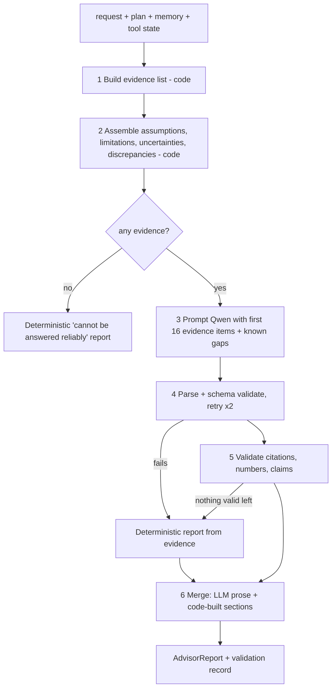

# Build prompt: Report Agent (CMF)

> **What this file is.** A build specification for the Report Agent. It is **not** documentation of existing code: the repository currently contains the Planner Agent, the frozen conversations,
> the synthetic operational data (`cmf_ops`) and its access layer only. Everything below is **to be built**. "Lessons" notes come from an earlier build (since removed) so its failures are not repeated.

## 0. Constraints
* The Report Agent receives **data only** (request, plan, memory context, tool results). It has no database handle, no MCP client and no write access; it cannot create or change memories.
* LLM: Qwen2.5 via the shared client; output validated with pydantic and then by deterministic checks (G). Mockable for tests.
* Never invent facts, numbers or citations. Synthetic operational data is never presented as something the client disclosed.

## A. Purpose and architectural role
It writes the advisor-ready answer by **synthesising** what the other agents produced: the Planner's scope, the Memory Orchestrator's reconstructed history, the Tool Selector's deterministic results.
It does not retrieve (no queries), calculate (no arithmetic that is not in a tool result) or remember (no memory writes). Keeping synthesis separate lets each source be audited and replaced.

**Interfaces**
| Source | Contract | What the Report Agent uses |
|---|---|---|
| Planner | `ExecutionPlan` | client_ids, task_type, needs_calculation, missing_information, success_criteria |
| Memory Orchestrator | `MemoryContext` per client | current understanding, superseded history, episodes (with certainty, status, dates), unresolved items, contradictions, notes, per-memory evidence (interaction_id, turn_index, speaker, excerpt) |
| Tool Selector | `ToolSelectorState` | executions (id, tool, arguments, status, result envelope with provenance and limitations), errors, missing_information, stop reason |
| Output | `AdvisorReport` | to the advisor / orchestrator |

## B. Inputs and outputs
Input: `write(request_text, plan, memory: dict[client_id, MemoryContext], tools: ToolSelectorState)`.
Output `AdvisorReport` (pydantic): `request_id, client_id, question, summary, key_findings[], historical_context[], financial_analysis[], evidence[], assumptions[], uncertainties[], limitations[], suggested_followups[], validation{}`.
`Finding = {text, refs[]}`; `EvidenceItem = {ref (E1..), source_class, description, interaction_id?, turn_index?, memory_id?, tool_execution_id?, excerpt?, synthetic}`;
`source_class` in {`conversation_evidence`, `memory`, `operational_data`, `tool_calculation`, `assumption`}.
The model's own output schema is smaller: `summary, key_findings, historical_context, financial_analysis, uncertainties, suggested_followups` (citations only by handle). Everything else is assembled by code.

## C. Workflow

Evidence ordering matters for a small model that only sees the first items: current memory first, then tool results, then superseded history and recent events. Keep prompt text per item short (about 300 characters) so a 6k-token context is not exceeded.

## D. Evidence and provenance
Each statement should be traceable by handle: conversation statements -> `interaction_id` + `turn_index` + excerpt (and the `memory_id` that holds it); consolidated knowledge -> `memory_id` (semantic version with validity dates); tool numbers -> `tool_execution_id` (e.g. `EX-REQ-ab12-03`) and the tool name/arguments/as-of date.
`synthetic = true` on every `operational_data` and `tool_calculation` item; `conversation_evidence` and `memory` items are not synthetic. Operational records linked to conversation evidence (via `data_evidence_links`) are still operational values.
A reader distinguishes sources by `source_class` and handle: "[E2 conversation_evidence] Client said in INT-090 turn 2" versus "[E21 tool_calculation, synthetic] calculate_goal_funding_gap ...". Never cite an interaction/turn that is not in the evidence list.

## E. Interpretation rules (also put in the system prompt)
| Kind | How to write it |
|---|---|
| Confirmed client decision | "decided", with date and evidence; only from `certainty=confirmed` |
| Exploratory / hypothetical | "was considering / explored", never as a plan or decision |
| Advisor recommendation | attribute to the advisor, not the client |
| Historical (superseded) | past tense with its validity window ("was 65 until 2026-05-01") |
| Current semantic knowledge | the single `active` value per topic, with its `valid_from` |
| Tool-calculated value | quote exactly, with the tool and as-of date; state the tool's limitations |
| System inference | label as inference; never as a client statement |
| Unconfirmed | say it is unconfirmed |
**Kenji example:** correct: "Kenji's confirmed retirement target is 63 (decided 2026-05-01, INT-090 turn 2), replacing the earlier plan of 65. He explored 60 (Jan-Mar) and 63 (Apr) before deciding; those were not decisions. The operational profile's retirement age must be compared with this and any difference reported."
Wrong but fully cited and numerically valid: "Kenji's retirement age is currently exploratory at 65" or "the current plan is 63 and also 65".
**Citations and correct numbers do not guarantee correct interpretation**: a model can cite a real superseded memory and quote a real number while stating the wrong time or status.

## F. Report structure (fields, in order)
`summary` (direct answer, 1-3 sentences) -> `key_findings` -> `historical_context` -> `financial_analysis` (tool-based, with as-of dates) -> `evidence` (all handles) -> `assumptions` (synthetic-data statement, tool assumptions) -> `uncertainties` (unresolved items, contradictions, missing information, tool errors, memory-vs-operational discrepancies with dates) -> `limitations` (collected from tool results; for feasibility questions: no projection exists) -> `suggested_followups` -> `validation` (what the checks removed or replaced).
A CLI renderer should print these headings; the structured object is the source of truth.

## G. Validation and reliability (build as code; each item is a test)
Implemented-in-earlier-build checks to rebuild: every `ref` must be an existing handle (invalid refs removed); a finding without a valid ref is dropped; every number in a finding or summary must occur in the evidence (allow years, small counts, rounding such as $3.54M); summary with an invented number is replaced by a deterministic summary;
if no finding survives, use a deterministic report from the evidence; if no evidence exists, say the question cannot be answered reliably and do not call the model; model failure falls back to the deterministic report; memory-vs-operational retirement-age discrepancy is surfaced with both dates; missing tool results add an explicit uncertainty; every cited conversation excerpt re-verified against `conversations.csv` in tests.
**Known failure (earlier real-Qwen runs, 3B):** reports cited real evidence with valid numbers but stated that the 63 decision was "still exploratory" or presented 65 and 63 as simultaneously current, using stale or superseded items. Those checks **did not catch it**; status: **unresolved** in the earlier build (the checks are about citations and numbers, not meaning). Do not report it as fixed.
**Recommendation (not implemented, build and test it):** a structured claim-validation layer. Have the model emit claims as `{subject, topic, value, status in {current, superseded, exploratory, recommendation}, evidence_ref}`; code checks each claim against the evidence item's `certainty`, `status` and validity window (a claim marked `current` must cite the active semantic memory; `exploratory` must cite exploratory episodes; at most one `current` value per topic; dates must fit validity windows), then renders the prose from validated claims. Also: client ownership check (every memory/evidence item belongs to a plan client); contradictory-evidence rule (report both sources with dates, never pick silently).

## H. Illustrative example reports (labelled illustrative; do not copy as results)
* **Kenji.** Summary: "Kenji's confirmed retirement target is 63 (decided 2026-05-01) [E1,E2]; it replaced a planning date of 65 [E3]. Retiring at 60 was explored, not decided [E5]." Uncertainty: operational profile age vs memory, if different. Limitation: no projection, simple funding gap only.
* **Rebecca.** "Rebecca declined the employee-ownership route on 2026-03-26 because a ten-year seller note would not give the certain cash needed for her mother's care [E1, INT-061 turn 11]. She later decided to sell to Lakeshore (2026-04-22) with the rollover cut to ten percent [E4]. Cash of about $220,000 (about 15 months of spending) was held as of the evidence date; the $600,000 care reserve is conditional on closing and is not in the investable portfolio [E6]."
* **Peg.** Use only open items that exist for her in the conversations (e.g. Maplewood Commons weighed then "decided against for now"; equity share changes). The pension survivor-benefit correction in the dataset belongs to Grace (CLIENT-004, INT-050); do not attribute it to Peg. State "no pension survivor benefit item was found for Peg" if asked.

## I. Testing and model evaluation
Tests with a scripted model: citation filtering; invented number rejected; summary replaced; fact/assumption separation; no-projection limitation for feasibility questions; memory-vs-operational conflict surfaced; missing information and unresolved items listed; no tool results => explicit gap; no evidence => no model call; model failure => deterministic report with citations; agent source contains no database/MCP imports.
Add the Kenji status tests that the earlier build lacked: the report must not call 63 exploratory and must not list 65 as current.
Real-model evaluation (earlier, `qwen2.5:3b`, CPU): report stage about 2 minutes for a memory-only question and about 5 minutes for a tool question; quality failures as in G. Not validated: larger Qwen models, all six clients with real ingestion, PostgreSQL-backed runs, report quality metrics.

## J. Limitations and future work
Implemented-in-earlier-build limits: validation is syntactic (citations, numbers), not semantic. Proposed: structured claim validation; temporal fact verification against validity windows; evidence-to-claim consistency checks; handling of conflicting memories beyond surfacing them; evaluation with a larger Qwen2.5 and a report-quality rubric; more reliable uncertainty phrasing. None of these exist in the repository today.
