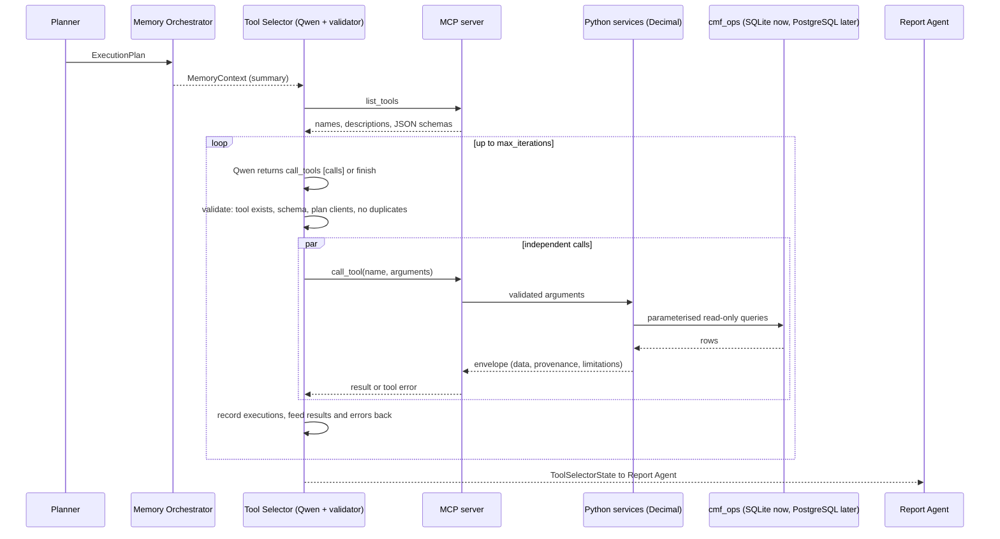

# Build prompt: Tool Selector Agent and MCP server (CMF)

> **What this file is.** A build specification for the Tool Selector Agent and the MCP server that exposes deterministic financial tools. It is **not** documentation of existing code:
> the repository currently contains the Planner Agent, the frozen conversations, the synthetic operational data (`cmf_ops`) and its read-only access layer `src/cmf_data/` only.
> Everything below is **to be built**. "Lessons" notes come from an earlier build (since removed).

## 0. Context and constraints
* Operational data: schema `cmf_ops` (tables `client_financial_profiles, client_expense_history, portfolio_accounts, portfolio_holdings, portfolio_transactions, portfolio_snapshots, financial_goals, liabilities, data_evidence_links, ref_*`),
  read through `src/cmf_data/access.py` (`OperationalData`). **Currently loaded only in a SQLite smoke-test copy (`build/cmf_ops_smoke.db`); live PostgreSQL has not been validated.** Select the backend with `CMF_DATABASE_URL`; tools must not know which backend is used.
* All operational values are **synthetic**; every tool result must say so in its provenance and carry its limitations.
* LLM: Qwen2.5 via the shared client (default `qwen2.5:3b`, CPU-only, slow). MCP SDK installed here is **v2** (`mcp.server.mcpserver.MCPServer`, `mcp.Client`).
* Do not modify the operational data, `conversations.csv`, or the Planner.

## A. Purpose and architectural role
The Tool Selector decides **which tools to call, with which arguments, in what order, and when to stop**, to collect the structured financial information a task needs. It is the dynamic tool-use layer of the four-agent system:
Planner (plan) -> Memory Orchestrator (client memory) -> **Tool Selector** (financial data and calculations via MCP) -> Report Agent (synthesis).

*Tool Selector vs MCP server.* The MCP server is a **protocol endpoint**: it lists tools with JSON schemas, validates arguments, runs deterministic Python and returns results. It makes no decisions.
The Tool Selector is an **LLM-driven agent**: it reads the request, plan, memory summary and tool catalogue, chooses calls, inspects results and decides whether more are needed.
*Why dynamic.* Different questions need different tools ("how concentrated is Rebecca's portfolio?" needs one calculation; "can Kenji retire at 63?" needs several and may need follow-ups when a result is insufficient).
A hard-coded sequence either over-fetches or fails when data is missing. The loop must have **no fixed call sequence**; the only non-LLM fallback is to run tools the Planner itself requested if the model is unavailable.

**Interfaces with other agents**
| Agent | Contract |
|---|---|
| Planner -> Tool Selector | `ExecutionPlan` (client_ids, task_type, required_data, `required_tools` as suggestions, missing_information) |
| Memory Orchestrator -> Tool Selector | `MemoryContext` summary (current values per topic, unresolved count) to avoid asking tools for what memory answers and to pick dates/clients |
| Tool Selector -> Report Agent | `ToolSelectorState`: executions (id, iteration, tool, arguments, status, result, error, duration, rationale), missing_information, completion status, stop reason, fallback flag |
| Tool Selector -> Memory Orchestrator | optional summaries for working memory (task-scoped, expiring) |

## B. Workflow

Steps: (1) receive request, plan, memory summary; (2) discover tools over MCP; (3) present a compact catalogue (name, required `*` and optional arguments with types, first sentence of description) to Qwen; (4) Qwen picks up to 5 calls or `finish`;
(5) code validates (see F); (6) execute valid calls concurrently via MCP; (7) summarise results (truncated digest) into the next prompt; errors are fed back with the message; (8) continue or stop; (9) return the state.
Prompt-size warning (lesson): a 3B model with a 4-6k context window needs short digests; truncation silently drops the end of the prompt.

## C. MCP integration
MCP (Model Context Protocol) is an open protocol by which a client discovers and calls tools on a server using JSON-RPC. Here it separates **tool exposure** (server) from **tool choice** (LLM agent), so tools can be tested, reused by other clients, and swapped without changing the agent.
Server: build with `MCPServer`; register each tool from one table (name, description, function); argument schemas come from the function type hints, so use `Literal[...]` for enumerations (the schema then lists the allowed values and rejects bad ones before execution).
Raise the SDK's `ToolError` for input errors so the message reaches the client (a plain exception returns only "Error executing tool").
Client: wrap `mcp.Client` in a small toolbox (`list_tools`, `call`) supporting in-process transport (default, same protocol, no subprocess) and stdio (spawn `python -m mcp_server.server`). Results are JSON text; parse into dicts.
Lesson: MCP v2 runs sync tool functions in worker threads, so a SQLite connection must be opened with `check_same_thread=False` (read-only), or a connection per call.
The LLM never sees the protocol; it sees the catalogue and returns structured calls.

## D. Tool catalogue (to build; names fixed so the Planner's tool list matches)
All tools: read-only; arguments `client_id` (string, must be in the plan and allowed for the session); dates `YYYY-MM-DD` and must be snapshot month-ends (2026-01-31 ... 2026-06-30) where a snapshot is needed; money returned as numbers rounded to cents; every result is an envelope
`{tool, client_id, as_of, data, provenance{source, note, row_provenance}, limitations[]}`; money arithmetic in `Decimal`.

| Category | Tool | Purpose | Inputs | Output (`data`) | Source | Limitations |
|---|---|---|---|---|---|---|
| Client data | `get_client_profile` | profile as of 2026-06-30 | client_id | age, income, monthly expenses, dependants, retirement_target_age, risk_category, liquidity_target_months, synthetic_fields | `client_financial_profiles` | partly synthetic; risk category is a label |
| Portfolio | `get_client_portfolio` | positions now or at a snapshot | client_id, as_of_date?, investable_only=true | positions[holding, asset class, sector, issuer, quantity, price, market value, liquidity], total_value | `portfolio_holdings`/`portfolio_snapshots` + accounts | excludes deferred comp and private interests by default; units and prices synthetic |
| Historical | `get_portfolio_history` | totals and asset-class % per month | client_id | snapshots[date, total, positions, allocation_pct] | `portfolio_snapshots` | six month-ends only |
| Goals / liabilities | `get_client_goals` | goal versions valid at a date | client_id, as_of_date?, include_history=false | goals[type, description, target_amount, target_date, confidence_level, status, amount_provenance, valid_from/to] | `financial_goals` | amounts may be synthetic (see amount_provenance) |
| | `get_client_liabilities` | loans and recurring obligations | client_id | liabilities[type, outstanding, rate, payment, maturity] | `liabilities` | balances amortised forward synthetically |
| Calculations | `calculate_asset_allocation` | % by group | client_id, as_of_date?, group_by in {asset_class, liquidity_category, sector, account_type} | allocation[group, value, percent], total | holdings/snapshots | no look-through into funds |
| | `calculate_portfolio_concentration` | top-N share and Herfindahl index | client_id, as_of_date?, dimension in {instrument, issuer, sector, asset_class}, top_n=5 | top[], top_n_percent, herfindahl_index, groups | holdings/snapshots | funds grouped by fund house; no look-through |
| | `compare_portfolio_snapshots` | added, removed, changed, allocation change, transactions between | client_id, date_a, date_b | added, removed, changed[quantity/value/price change], allocation_change, transactions_between | snapshots + `portfolio_transactions` | month-end resolution |
| | `calculate_portfolio_returns` | price-only returns between snapshots | client_id, start_date, end_date | simple change, net external flows, flow-adjusted change, Modified Dietz %, per-holding price returns | snapshots + transactions | **not** time-weighted; no income, fees, benchmark; history starts 2026-01-31 |
| | `calculate_liquidity_ratio` | cash (and cash plus daily-liquid) / monthly expenses | client_id, as_of_date? | monthly_expenses (valid on the date), cash months, target months, shortfall, by liquidity category | holdings + `client_expense_history` | known future expenses are not in the data |
| | `calculate_goal_funding_gap` | **simple** gap = target - resources | client_id, goal_id?, goal_type?, as_of_date?, resources_basis in {investable_portfolio, cash_equivalents} | goals[target, resources, simple_gap, coverage %, provenance], skipped | goals + snapshots | not a projection (no growth, inflation, contributions, drawdown, taxes) |
| Market data | `get_market_data` | the synthetic shared market path | as_of_date? | monthly equity and bond returns | `ref_market_path` | fictional; not real market data |
| Evidence | `get_source_evidence` | evidence for a record or a conversation turn | client_id, entity_type+entity_id or interaction_id+turn_index | evidence[excerpt, kind, verified_in_conversations] or the turn text | `data_evidence_links` + `conversations.csv` | only verified references |

**Do not build** (no data source exists; they would force invented results): `get_pending_actions`, `calculate_risk_metrics`, `calculate_rebalancing_scenarios`, `search_market_research`, `search_economic_indicators`, `search_client_documents`. State this in the catalogue documentation.

## E. Dynamic selection: expected behaviour
1. *"What is Kenji's current retirement target, and how did it evolve?"* Memory already holds the answer (65 -> 63). Expected: `finish` with no tools, or at most `get_client_profile` to compare the operational `retirement_target_age` with memory. Calling portfolio tools is a failure of selection.
2. *"Can Kenji retire at 63 based on the available financial data?"* Iteration 1, in parallel: `get_client_profile`, `get_client_goals` (retirement goal), `get_client_portfolio`, `get_client_liabilities`. Iteration 2 (depends on the goal id and portfolio): `calculate_goal_funding_gap` with `goal_type="Retirement"`, `calculate_asset_allocation`, `calculate_liquidity_ratio`. Then `finish` with `missing_information`: no projection tool exists, so feasibility cannot be confirmed.
3. *"How concentrated is Rebecca's portfolio?"* Resolve CLIENT-002; call `calculate_portfolio_concentration` for dimensions `issuer`, `sector`, `instrument` (independent, same iteration); optionally `get_client_portfolio` to show the largest holdings. Finish; note that the company stake is outside the investable portfolio and funds are not looked through.
Selection is validated by tests with a scripted model (which tools were called, in which iteration), not by prose.

## F. Execution control (configurable constants; defaults to use)
| Control | Default |
|---|---|
| Max iterations | 5 |
| Max successful or failed tool executions per request | 12 |
| Max calls per iteration | 5 |
| Model output retries per iteration | 2 (then fallback) |
| Per-call timeout | 90 s |
| Stop if no new valid call proposed | twice in a row |

Validation before any call: tool name exists; arguments satisfy the tool's JSON schema (types, enums, required); no unknown arguments; `client_id` belongs to the plan; no repeat of an earlier **successful** call (status `duplicate`, same batch included).
Rejected and failed calls are recorded with the message and fed back, so the model can fix dates or choose another tool. Independent calls run concurrently (`asyncio.gather`); dependent calls wait for the next iteration.
Missing data: the model must return `finish` with `missing_information`; it must not guess. Model unavailable on the first iteration: run only the tools the Planner requested that need `client_id` only, and flag `fallback_used`.
Replanning: if tool discovery fails the orchestrator asks the Planner to replan without tools and records the gap. Security: no SQL or write tools, parameterised queries only (inside `cmf_data`), read-only connection, a session client allow-list (`CMF_ALLOWED_CLIENTS`) enforced by the server, no credentials in prompts or traces.
Lesson: an unvalidated date (2026-07-31) was proposed by the real 3B model; it was caught by the tool and recorded, which is the intended behaviour.

## G. Financial calculation architecture
LLM chooses tools and arguments; MCP exposes them; Python (`Decimal`) calculates; the database (SQLite now, PostgreSQL later) stores the synthetic operational data. LLM arithmetic is unreliable and unauditable, so no number may originate from the model.
Supported calculations are exactly those in D; their limits are returned with every result (`limitations`) and must be surfaced by the Report Agent. Totals reconcile to the sum of rounded holding values; Modified Dietz uses the dated external flows from `portfolio_transactions`.

## H. Data architecture
Tools read **only** `cmf_ops` through `cmf_data` (read-only). They do not read or write `cmf_memory`; the only bridge is the structured summaries the orchestrator passes between agents. Configuration: `CMF_DATABASE_URL` (default `sqlite:///build/cmf_ops_smoke.db`).
SQLite smoke testing is the only validation done so far; do not state PostgreSQL parity until `load_db.py --reset` and the tool tests have run against a live server.

## I. Tracing
Each request writes a JSONL trace (`logs/traces/<request_id>.jsonl`, secrets redacted): `tools_discovered`, per-iteration `decision` (calls and arguments), `call_rejected/call_duplicate`, `tool_result` (execution id, tool, arguments, status, duration, digest), `finished` (status, stop reason, iterations, call list).
Execution ids are `EX-<request_id>-NN` and are what the Report Agent cites. Provide a CLI to print a trace (suggested: `python -m orchestration.cli trace <request_id>`).

## J. Testing
Tests (scripted model, real in-process MCP): discovery lists exactly the registered tools with schemas; stdio transport works; sequential then finish; parallel independent calls in one iteration; duplicate prevention; invalid tool/argument/client rejected then recovered; tool error recorded and loop continues;
iteration and call limits; fallback when the model fails; missing information reported; trace events present; client allow-list; no write/SQL tool exists; calculation tests against hand-computed values (allocation sums to 100%, liquidity ratio, funding gap, returns, snapshot comparison).
Real-model validation: measured earlier on one request, the 3B model took minutes (tool phase about 6.5 minutes for a feasibility question). Re-measure; do not claim reliability from mocks.

## K. Limitations and future
Unavailable (no data source): pending actions, market research, economic indicators, risk metrics, rebalancing, client documents. No retirement projection. Tool results are summarised and truncated for a small context window.
Future: a projection tool with explicit assumptions, larger-model evaluation, tool-result caching across requests, real market-data providers (outside this proof of concept).
